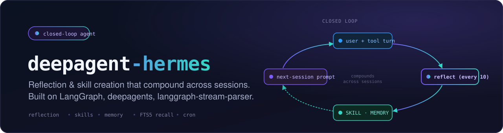

<p align="center">
  
</p>

# langstage-hermes

[](https://pypi.org/project/langstage-hermes/)
[](https://pypi.org/project/langstage-hermes/)
[](./LICENSE)

<p align="center">
  
</p>

<p align="center"><sub><code>langstage-hermes demo</code>, <code>search</code> and <code>skills list</code>, keyless, recorded by CI against the latest release. <a href="https://dkedar7.github.io/langstage-docs/stages/hermes/">Docs for langstage-hermes</a></sub></p>

A faithful reproduction of [Nous Research's Hermes Agent](https://github.com/nousresearch/hermes-agent) on top of LangGraph + [`deepagents`](https://github.com/langchain-ai/deepagents) + [`langstage-core`](https://github.com/dkedar7/langstage-core).

**Status: live on PyPI** (renamed from `deepagent-hermes` — the old name now just installs this one, and the `deepagent-hermes` command still works, with a deprecation notice). Spec at [SPEC.md](./SPEC.md). Release notes in [CHANGELOG.md](./CHANGELOG.md). The runtime is verified end-to-end against a real Anthropic model — both the memory loop and the skill-creation loop close autonomously; see [`examples/dogfood.py`](./examples/dogfood.py) and [`examples/dogfood_procedural.py`](./examples/dogfood_procedural.py) for the traces.

## What it is

A `deepagents`-built agent with a **closed reflection→skill-creation loop**:

- After ~10 tool-using iterations (`skills.creation_nudge_interval`) or ~10 user turns (`memory.nudge_interval`), a review subagent runs when the turn ends. It writes/patches a `SKILL.md` capturing the pattern it just exercised, ships it to a skill library, and saves durable notes to memory. It runs on the aux model (`model.aux_model`) before your next prompt, so that turn takes a little longer and costs a few aux-model calls.
- Next session, the agent reads the library at startup, sees the new skill's description in its system prompt, and can `skill_view(name)` to load the full body on demand (progressive disclosure per the [agentskills.io spec](https://agentskills.io/specification.md)).
- A weekly **curator** consolidates skills into umbrellas and archives stale ones.
- A **frozen-snapshot memory** (`MEMORY.md` + `USER.md`) preserves prefix-cache hits for the entire session.
- **FTS5 session search** indexes every past conversation in a local SQLite DB.
- Bundled **MarkdownProvider** that keyword-searches `<HERMES_HOME>/memories/notes/*.md` — drop hand-authored long-form context there and the agent surfaces relevant sections on demand. Zero external dependencies.

Designed to be loaded into the LangStage host family without UI changes — set `LANGSTAGE_AGENT_SPEC=langstage_hermes.agent:graph` in any of them.

## Every stage for your LangGraph agent

langstage-hermes is the reference agent of the **LangStage family**: write your agent once — any LangGraph `CompiledGraph` — and run it on every stage with the same spec string (`module:attr` or `path/to/file.py:attr`), the same `langstage.toml` config file, and the same `LANGSTAGE_*` environment variables.

| Stage | Package | Try it |
|---|---|---|
| Web app | [langstage](https://github.com/dkedar7/langstage) | `langstage run --agent langstage_hermes.agent:graph` |
| JupyterLab | [langstage-jupyter](https://github.com/dkedar7/langstage-jupyter) | `pip install langstage-jupyter`, then the chat sidebar in `jupyter lab` |
| Terminal | [langstage-cli](https://github.com/dkedar7/langstage-cli) | `langstage-cli -a langstage_hermes.agent:graph` |
| VS Code | [langstage-vscode](https://github.com/dkedar7/langstage-vscode) | chat participant + stdio sidecar |
| Reference agent | langstage-hermes | **you are here** |
| Shared core | [langstage-core](https://github.com/dkedar7/langstage-core) | AG-UI streaming bridge + config resolver behind every stage |

### Serve over AG-UI

This surface's agent — any LangGraph `CompiledGraph` — can also be served over the [AG-UI protocol](https://github.com/dkedar7/langstage-core) as a standalone HTTP endpoint. Install the extra and point the bundled console script at your agent spec:

```bash
pip install "langstage-core[agui]"
langstage-agui --agent langstage_hermes.agent:graph
```

📖 **Full documentation:** <https://dkedar7.github.io/langstage-docs/>

## Installation

```bash
pip install langstage-hermes
```

Or with `uv` (recommended):

```bash
uv venv .venv
. .venv/Scripts/activate      # Windows
. .venv/bin/activate          # macOS / Linux
uv pip install langstage-hermes
```

### Optional extras

```bash
pip install "langstage-hermes[openai]"     # OpenAI / OpenRouter / any OpenAI-wire provider
pip install "langstage-hermes[daytona]"    # Daytona sandbox terminal backend
pip install "langstage-hermes[modal]"      # Modal sandbox terminal backend
pip install "langstage-hermes[ssh]"        # paramiko-backed SSH terminal backend
pip install "langstage-hermes[dev]"        # tests + lint (contributors only)
```

## Picking a model

By default the agent uses `anthropic:claude-sonnet-4-6` and needs `ANTHROPIC_API_KEY` set. Swap the model via `--model` on the CLI or `model.default` in `langstage-hermes.toml` — any [`init_chat_model`](https://python.langchain.com/api_reference/langchain/chat_models/langchain.chat_models.base.init_chat_model.html) string works.

### OpenAI / OpenRouter

```bash
pip install "langstage-hermes[openai]"
export OPENAI_API_KEY=sk-…                   # or: OPENROUTER_API_KEY=sk-or-v1-…
export OPENAI_BASE_URL=https://openrouter.ai/api/v1   # only for OpenRouter
langstage-hermes chat --model openai:openai/gpt-4o-mini
```

For OpenRouter specifically you usually also want:

```bash
export LANGSTAGE_HERMES_MODEL_DEFAULT="openai:openai/gpt-4o-mini"
export LANGSTAGE_HERMES_MODEL_AUX="openai:openai/gpt-4o-mini"
```

so the reflection subagent uses the same cheap model.

### Verify your setup

```bash
langstage-hermes verify
```

does one live round-trip against the configured model and confirms the prompts, bundled skills, and FTS5 store all wire up correctly. Run this first on any fresh install — if it passes, `chat` will work. The offline checks (bundled prompts and skills, a writable `HERMES_HOME`, and that the FTS5 store opens) run before the key check, so even a keyless run tells you the install itself is sound.

Both `verify` and `doctor` accept `--json` for scripting/CI — a top-level `ok` plus a per-check list, with `.ok` equal to `exit code == 0` (so `langstage-hermes doctor --json | jq -e .ok` is a one-liner readiness gate). `verify --json` reports the live round-trip as `skipped` when no key is set, so a keyless CI check never triggers a paid call.

### Exit codes

Every `langstage-hermes` command (and the deprecated `deepagent-hermes` alias, and `python -m langstage_hermes.cron`) uses the LangStage family exit codes ([core ADR 0007](https://github.com/dkedar7/langstage-core/blob/main/docs/adr/0007-family-exit-codes.md)):

| Code | Meaning |
|---|---|
| `0` | success |
| `1` | failure: `verify` / `doctor` not ready (missing key or provider package, a failed check or round-trip), `chat` can't start (missing key, bad `--agent`, agent build failed), a skill that won't install, an item not found, the cron daemon can't start |
| `2` | paused on a human-in-the-loop interrupt (reserved; no hermes command exits 2 today) |
| `64` | usage error: an unknown command or flag, a bad option value, conflicting options (`search --session` without `--around`, `--json` without `--show-config`), an invalid `cron create --schedule` |

## Quick start

```bash
# show resolved config + sources
langstage-hermes --show-config

# interactive chat
langstage-hermes chat

# chat against a different agent (same spec format as every LangStage
# stage; overrides LANGSTAGE_AGENT_SPEC)
langstage-hermes chat -a my_agent.py:graph

# from inside chat:
#   /skills            list available skills
#   /model anthropic:claude-haiku-4-5-20251001    switch models
#   /memory            dump current memory snapshot
#   /compress          force context compression
#   /quit
```

## Search your session history

Every conversation is indexed in a local SQLite FTS5 store at `<HERMES_HOME>/state.db`. Query it from the terminal — **keyless and offline, no model call** — in the three documented modes:

```bash
# DISCOVERY — BM25 top-N with a highlighted snippet (prints session_id + message_id)
langstage-hermes search "profile slow python"
langstage-hermes search "profile slow python" --limit 10 --json

# SCROLL — a ±window view centred on a message (window clamped 1–20)
langstage-hermes search --session sess-1a2b3c --around 8 --window 5

# BROWSE — recent sessions, newest first (also the default with no query)
langstage-hermes search --browse --limit 20
```

`--json` emits structured output for scripting/CI. The same flag is honored by `skills list`, `skills audit`, `audit log`, `memory show` / `memory notes`, the readiness checks `doctor` / `verify`, `--show-config`, and the `cron` subcommands (`list`, `create`, `run-due`, `delete`, `pause`, `resume`) — so the skill inventory, mutation log, setup diagnostics, and scheduler are all scriptable too (each prints one JSON object with stable keys). FTS5 syntax works: multi-word queries default to AND, and `OR`, quoted `"phrases"`, and prefix `wildcards*` are all honored.

Want a store to try it against, keyless? Point `HERMES_HOME` at a directory and run `langstage-hermes demo` — with `HERMES_HOME` set the demo copies its session (and only its session) into that same `<HERMES_HOME>/state.db`, so `search` reads it straight back:

```bash
export HERMES_HOME=~/.langstage-hermes    # any stable directory
langstage-hermes demo                     # populates <HERMES_HOME>/state.db
langstage-hermes search "python"          # finds the demo session
```

(The loop itself always runs in a throwaway home that is cleaned up afterwards — pass `--keep-workspace` to inspect it — so the demo's generated skill and scripted user-memory note never land in your real skill library or `USER.md`. A bare `langstage-hermes demo` with no `HERMES_HOME` set writes nothing outside that throwaway home.)

## Preview your notes

Drop hand-authored long-form context in `<HERMES_HOME>/memories/notes/*.md` and the bundled **MarkdownProvider** surfaces relevant sections to the agent on demand (enable it with `memory.provider = "markdown"`). Preview exactly what it will recall from the terminal — **keyless and offline, no model call** — so note authors get a feedback loop without a chat turn:

```bash
langstage-hermes memory notes "rollback"            # prints the source file + matching section
langstage-hermes memory notes "rollback" --json     # {"query", "count", "results":[{file, section, snippet}]}
```

Recall is the same dumb-but-robust keyword overlap the agent uses (query tokens ≥ 3 chars, ranked by distinct hits). `--limit N` caps the sections returned; a missing/empty notes dir or a no-match query prints a clear message, never a traceback.

## Read your memory

The **frozen-snapshot memory** (`MEMORY.md` + `USER.md`) is the layer the agent grows about you and the session, but inside a chat only the `/memory` slash command could read it — and `chat` needs an API key. Dump the current snapshot straight from the terminal — **keyless and offline, no model call** — to answer "what has the agent learned about me?" without spending a turn:

```bash
langstage-hermes memory show                 # both USER.md + MEMORY.md, with char count vs budget
langstage-hermes memory show --user          # just USER.md
langstage-hermes memory show --session       # just MEMORY.md
langstage-hermes memory show --json          # {"user": {...}, "memory": {...}} for scripting / CI
```

Each layer prints its char count against the configured char budget (`memory_char_limit` = 2200, `memory_user_char_limit` = 1375) so you can see when a snapshot is near or over budget. Nothing is truncated: an over-budget layer (e.g. a hand-edited `USER.md`) is still injected in full every turn, and the agent's `memory` tool rejects new entries for it until it is trimmed back under budget. A missing/empty layer prints a clear one-line message, never a traceback (`memory dump` is an alias for `memory show`).

## Load into an existing host

Any LangStage host can run this agent:

```bash
# langstage-cli
LANGSTAGE_AGENT_SPEC="langstage_hermes.agent:graph" langstage-cli

# langstage-jupyter — set the same in langstage.toml under [agent]
printf '[agent]\nspec = "langstage_hermes.agent:graph"\n' >> langstage.toml
langstage-jupyter
```

## Add Hermes to an existing agent

Already have a LangGraph agent? Keep your model, tools and system prompt, and add Hermes's learning loop as middleware with `hermes_middleware()`:

```python
from langchain.agents import create_agent
from langchain.chat_models import init_chat_model
from langchain_core.tools import tool
from langgraph.checkpoint.memory import InMemorySaver

from langstage_hermes import hermes_middleware


@tool
def lookup_order(order_id: str) -> str:
    """Look up an order by id."""
    return f"order {order_id}: shipped"


model = init_chat_model("anthropic:claude-sonnet-4-6")
agent = create_agent(
    model,
    tools=[lookup_order],
    system_prompt="You are Acme's support agent.",
    middleware=[*hermes_middleware(aux_model=model)],
    checkpointer=InMemorySaver(),
)
agent.invoke(
    {"messages": [{"role": "user", "content": "Where is order 42?"}]},
    {"configurable": {"thread_id": "demo"}},
)
```

What you get by default:

| Component | What it adds |
|---|---|
| `reflection` | Every few turns a review subagent looks back over the conversation and saves what worked as a skill or a memory entry |
| `skills` | The skill library (`skills_list`, `skill_view`, `skill_manage`) and its index in the prompt |
| `memory` | The `memory` tool, plus your saved memory and user profile in the prompt |
| `recorder` | Every turn written to `<HERMES_HOME>/state.db`, searchable with `session_search` |
| `curator` | Archives skills nobody has used in a while |

Opt in to more with `include=`: `compression` (summarise long contexts), `todo` (`write_todos`), `cronjob` (the agent manages its own scheduled jobs, and `create`, `resume` and `run-now` wait for your approval) and `budget` (cap tool-loop iterations). Leave a default out with `exclude=`, e.g. `hermes_middleware(include=["cronjob"], exclude=["curator"])`. An unknown name raises `ValueError`.

- **Your prompt stays yours.** Hermes appends its sections (tool guidance, your memory and user profile, the skills index) after your system prompt and never replaces it.
- **Tools come with the middleware.** `create_agent` binds `memory`, the skill tools and `session_search` from the middleware, so you don't list them.
- **`aux_model`** is the model the review subagent uses. Pass your own model (as above) to keep Hermes on the same provider and key; otherwise it uses `model_aux` or `model_default` from your Hermes config.
- **It also works with `deepagents.create_deep_agent(..., middleware=[*hermes_middleware()])`.** Don't include `todo` there, since deep agents already have it.
- **Config** comes from `langstage-hermes.toml` and `LANGSTAGE_HERMES_*` as usual: `HERMES_HOME`, nudge intervals, memory limits and `[agent] disabled_toolsets` all apply. Pass `config=HermesConfig.resolve(overrides={...})` to set them in code.
- The returned list also carries `.store`, `.library` and `.session_id`, and `.close()` closes its SQLite connections.
- Conversations are recorded under `.session_id` (pass `session_id=` to choose it), and `session_search` leaves that live session out of its results. To keep separate conversations as separate sessions, build one list per conversation, or put a `session_id` in each run's input state: `agent.invoke({"messages": [...], "session_id": "chat-7"}, ...)`.

Not included, because they belong to your agent: the filesystem tools, model switching, prompt caching and Hermes's own identity prompt. Use `create_hermes_agent()` when you want the whole Hermes agent.

## Configuration

`langstage-hermes.toml` (project) or `$HERMES_HOME/config.toml` (global — default `~/.langstage-hermes/config.toml`, and it moves with a custom `HERMES_HOME`). Layered resolution: `defaults < TOML < LANGSTAGE_HERMES_* env < CLI overrides`. See [SPEC §2](./SPEC.md#2-configuration) for every field; `langstage-hermes --show-config` prints the resolved value + source of each, and `langstage-hermes --show-config --json` prints the same thing as one JSON object (`{"config": {<field>: {value, source, env, legacy_env, toml}}, "toml": {...}, "issues": [...]}`) for CI. The legacy project filename `deepagent-hermes.toml` is still read, with a one-time deprecation note on stderr (silence it with `LANGSTAGE_SUPPRESS_LEGACY_NOTICE=1`).

### Let the agent schedule cron jobs

The agent has no `cronjob` tool unless you turn it on:

```toml
# langstage-hermes.toml
[cron]
agent_tool = true   # or LANGSTAGE_HERMES_CRON_AGENT_TOOL=true
```

With it on, you can ask in a chat for "a summary of this repo every morning at 9" and the agent schedules the job itself. `list`, `show`, `pause` and `delete` run straight away. `create`, `resume` and `run-now` start or restart unattended runs, so they pause first and show you what the agent wants to schedule or run, and nothing happens until you approve. The web and terminal stages show their usual Approve / Reject controls. `langstage-hermes chat` asks `approve? [y/N, or type a reason to reject]` (`/yolo` approves automatically). A cron run's own agent never gets the tool, and `[agent] disabled_toolsets = ["cronjob"]` turns it off even with the flag on.

## Architecture

See [SPEC.md](./SPEC.md) for the full 21-section requirements doc. Top-level layout:

- `src/langstage_hermes/agent.py` — the compiled graph (entry point for hosts)
- `src/langstage_hermes/config.py` — `HermesConfig(HostConfig)` resolver
- `src/langstage_hermes/state.py` — `HermesState` (extends `AgentState`)
- `src/langstage_hermes/reflection.py` — closed-loop middleware + review subagent
- `src/langstage_hermes/skills/` — SkillLibrary, loader, tools
- `src/langstage_hermes/memory/` — frozen-snapshot memory + provider ABC
- `src/langstage_hermes/store/sqlite_fts.py` — `BaseStore` with FTS5
- `src/langstage_hermes/search/session_search.py` — `session_search` tool
- `src/langstage_hermes/compression.py` — `HermesCompressionMiddleware`
- `src/langstage_hermes/caching.py` — `AnthropicCachingS3Middleware`
- `src/langstage_hermes/budget.py` — `IterationBudgetMiddleware`
- `src/langstage_hermes/tools/` — registry + 33 toolsets + 6 terminal envs
- `src/langstage_hermes/cron/` — daemon + `cron` CLI + the opt-in, approval-gated `cronjob` tool
- `src/langstage_hermes/plugins/` — discovery + lifecycle hooks
- `src/langstage_hermes/cli.py` — `langstage-hermes` entry point
- `prompts/` — verbatim/paraphrased system-prompt building blocks

## Status by subsystem

| Subsystem | Status |
|---|---|
| Config + state + agent factory | ✅ working |
| Reflection loop (10-iter / 10-turn triggers, subagent review) | ✅ working — verified live |
| Skill library + agentskills.io validator | ✅ working |
| Skill loader (system-prompt injection + progressive disclosure) | ✅ working |
| `skill_view` / `skill_manage` / `skills_list` tools | ✅ working |
| Frozen-snapshot memory (MEMORY.md / USER.md) | ✅ working — verified live (702 bytes written autonomously); also a keyless `langstage-hermes memory show` CLI (`--user` / `--session` / `--json`) |
| SQLite FTS5 store + `session_search` (3 modes) | ✅ working — also a keyless `langstage-hermes search` CLI (DISCOVERY / SCROLL / BROWSE, `--json`) |
| `MarkdownProvider` (bundled, opt-in via `memory.provider="markdown"`; the default is no-op) | ✅ keyword search over `<HERMES_HOME>/memories/notes/*.md` — zero deps; also a keyless `langstage-hermes memory notes` CLI (`--json`) |
| Iteration budget middleware | ✅ working |
| Compression middleware (13-section template) | ✅ working |
| Anthropic `system_and_3` caching strategy | ✅ working |
| Tool registry + 33-toolset enum | ✅ working — `langstage-hermes tools` lists the tool names the model is actually given, marking toolsets your config turns off (`[agent] disabled_toolsets`, or `cronjob` without `[cron] agent_tool = true`) with `✗`; `clarify` is declared but not bound |
| `LocalEnvironment` terminal backend | ✅ working (Git Bash on Windows); the agent gets the `execute` shell tool only when built with a sandbox `backend=` — the default workspace backend has no shell |
| `DockerEnvironment` | ✅ working (gated on `docker info` reachability) |
| `SshEnvironment` | ✅ working (paramiko-backed, behind `[ssh]` extra) |
| `SingularityEnvironment` | ✅ working (auto-detects `singularity` / `apptainer`) |
| `DaytonaEnvironment` / `ModalEnvironment` | ✅ lazy SDK with defensive attribute probing (extras-gated) |
| Cron daemon + `cron` CLI (also `/cron <subcommand>` in chat) | ✅ working (deliverers: `local`, `stdout`, `agentmail`); with `[cron] agent_tool = true` the agent can manage jobs too, and asks before it creates, resumes or runs one |
| Plugin loader (4 discovery sources) | ✅ working (13 of 17 lifecycle hooks wired) |
| CLI + v1-essentials slash commands | ✅ working |
| Curator (skill lifecycle) | ✅ basic |
| Bundled skills | ✅ 26 from `nousresearch/hermes-agent` (MIT, attributed) |
| Self-evolution integration | 📄 docs only (separate offline repo) |

## License

MIT. See [LICENSE](./LICENSE). This project is a faithful reproduction of the design ideas in Nous Research's Hermes Agent — see [NOTICE](./NOTICE) for attribution.
